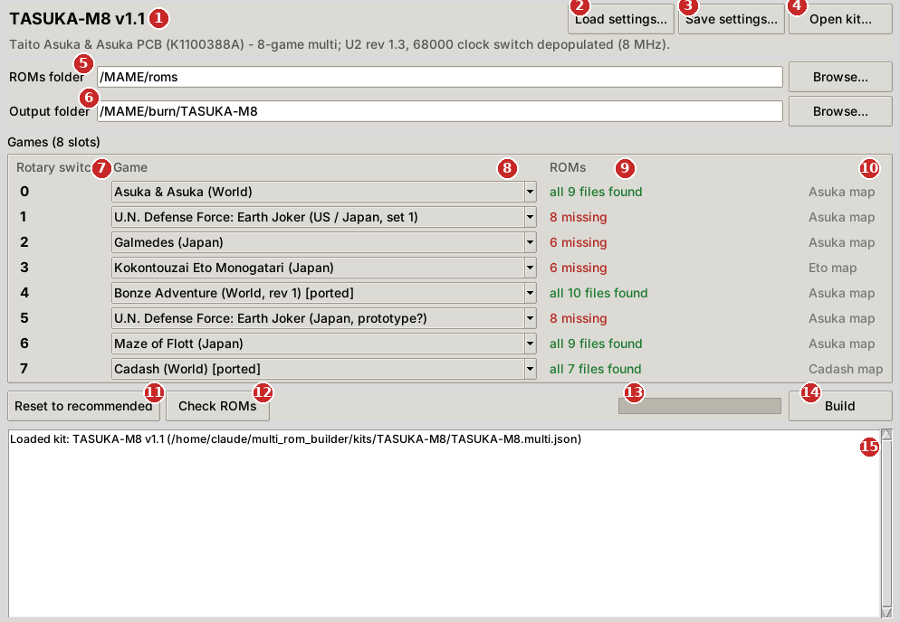
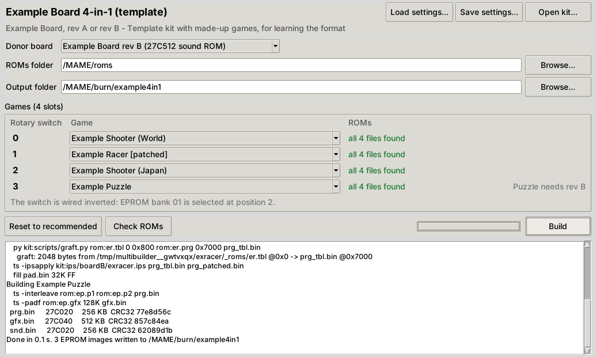

# Multi Builder user guide

Multi Builder makes the EPROM images for an arcade multi-game kit from your own MAME ROM sets. You choose which game goes at each switch position, press **Build**, and burn the files it writes.

Everything about a particular multi (its chips, its switch, which games fit where) comes from that multi's **kit**, so the window looks slightly different for each multi. This guide uses the TASUKA-M8 kit for the pictures.

- [Getting started](#getting-started)
- [The main window](#the-main-window)
- [Donor PCB drop-down](#donor-pcb-drop-down)
- [What a build produces](#what-a-build-produces)
- [Saving and loading settings](#saving-and-loading-settings)
- [Command line](#command-line)
- [Troubleshooting](#troubleshooting)

## Getting started

1. Download the build-tools zip for your multi and your operating system, for example `TASUKA-M8_build_tools_Windows.zip`. Unzip it anywhere. The folder holds the program, the kit file (`*.multi.json`) and the kit's patches and scripts. Keep them together.
2. Start the program:
   - **Windows:** `MultiBuilder.exe`
   - **macOS:** `MultiBuilder.app`. The first time, right-click it and choose **Open**, because the app isn't signed.
   - **Linux:** `./MultiBuilder`
3. The program opens the kit beside it. Choose your ROMs folder, check the games, and press **Build**.

You don't need Python or anything else installed.

## The main window



| # | Item | What it does |
|---|---|---|
| 1 | **Kit title** | The kit that's loaded, with the board it's for and its requirements underneath (for example "U2 rev 1.3, 68000 clock switch depopulated"). Check this line matches your hardware. |
| 2 | **Load settings...** | Opens a settings file saved earlier (see [Saving and loading settings](#saving-and-loading-settings)). It restores the kit, donor PCB, folders and every game choice, so you can change one game and build again. |
| 3 | **Save settings...** | Saves your current choices to a file you name. |
| 4 | **Open kit...** | Loads a different kit file (`*.multi.json`). You only need this if the program isn't in the kit's folder, or for kit makers testing a kit. |
| 5 | **ROMs folder** | The folder that holds your MAME ROM sets. **Browse...** picks it. Details below the table. |
| 6 | **Output folder** | Where the EPROM images are written. It's created if it doesn't exist. If it already holds images from an earlier build, you're asked before they're replaced. |
| 7 | **Selector column** | The position the player selects on the cabinet for each game. The kit sets the heading ("Rotary switch", "DIP switch", "Switch") and the position names (0-7, OFF/ON, ...). Rows are listed by position, even when the switch is wired in an unusual order; the kit takes care of where each game goes in the EPROMs. |
| 8 | **Game drop-down** | The game or region at that position. A position only lists the games that work there, which depends on the hardware wiring (and on your donor PCB, if the kit has a choice). Games marked **[ported]** or **[patched]** are modified at build time. |
| 9 | **ROMs status** | Whether the files for that game were found in your ROMs folder. See the status list below. |
| 10 | **Slot note** | The kit's note for that position, for example which address map it uses. A note under the whole list explains anything special about the switch. |
| 11 | **Reset to recommended** | Puts the kit's recommended game back at every position. |
| 12 | **Check ROMs** | Checks the ROMs folder again. Use it after adding or replacing ROM files while the program is open. The check also runs by itself whenever you change a game or the folder. |
| 13 | **Progress bar** | Progress of the current build. |
| 14 | **Build** | Builds the images. Nothing is written unless every input ROM is found and correct. |
| 15 | **Log** | What the program did: the kit it loaded, each file it used and where it found it, every step of the build, and the size and CRC32 of every image written. If a build fails, the reason is the last thing in the log. |

### ROMs folder

- Zipped sets (`cadash.zip`) and unzipped set folders (`cadash/`) both work.
- Split, merged and non-merged sets all work. Files are found by their CRC32, not just their names, so a clone's files can sit inside the parent's zip.
- If a file isn't in the set it normally belongs to, every other zip in the folder is searched for it by CRC.
- `.7z` archives aren't supported. Extract them, or convert them to zip.
- The files must match the versions the kit was made for, which are the ones in current MAME sets.

### ROMs status

| Status | Meaning |
|---|---|
| all *N* files found (green) | Every file the game needs is present and correct. |
| *N* missing (red) | That many files aren't in the ROMs folder. Check the set is there and complete. The log lists each missing file by name. |
| *N* wrong version (red) | A file with the right name was found, but its contents (CRC) differ. Usually it's an older or newer dump than MAME's current set. Update the set. |
| checking... | The check is running. |
| choose a ROMs folder | No ROMs folder is set yet. |

A red position doesn't stop you building, as long as you swap it to a game you do have: a build with any red game still chosen stops at the ROM check without writing anything.

## Donor PCB drop-down

Some multis fit more than one donor board, for example two revisions of the same PCB, or two games' boards that differ in a chip or two. Those kits show an extra drop-down at the top:



Choose the board your multi is going into. Changing it can:

- change which games each position offers (games that can't run on that board are hidden),
- change the recommended game at a position,
- change the patches applied, or which EPROM images are built and what size they are.

Kits that only fit one board don't show this drop-down.

## What a build produces

The output folder gets:

- **The EPROM images**, one `.bin` per chip on the multi board, named by the kit (`prg1.bin`, `snd1.bin`, ...). The chip type for each is shown in the log and in the report. Burn them as they are: they're already the full chip size.
- **`build_report.txt`**: which game is at each position, plus the chip type, size, CRC32 and SHA1 of every image. Keep it with your burned chips; the CRCs let you confirm a chip was burned and read back correctly.
- **`build_settings.json`**: your exact choices for this build. You can load it with **Load settings...**, or pass it to the command line to repeat the build.

Every build checks that:

- every input file is present and correct,
- every patch and script ran without error,
- each game's data is exactly the size of its slot in each chip (and, for patched games, has exactly the expected contents),
- every image is the right size for its chip and reads back correctly from disk.

If any check fails, the build stops and the log says why. The ROM check happens first, so a missing or wrong file stops the build before anything is written.

## Saving and loading settings

The program remembers your folders and choices from one run to the next by itself. Settings files are for when you want to keep more than one configuration, share one, or script a build.

- **Save settings...** writes a small JSON file holding:
  - the kit
  - the donor PCB
  - the ROMs and output folders
  - the game at each position
- **Load settings...** reads one back into the window. If the kit isn't where the file says, open the kit first (**Open kit...**) and then load the settings again.
- Every build also leaves its own `build_settings.json` in the output folder, so you always have a record of exactly what was built.

The files are plain text. Here is one for the TASUKA-M8, with Jigoku Meguri at position 4 instead of Bonze Adventure:

```json
{
  "multibuilder_profile": 1,
  "kit": "TASUKA-M8.multi.json",
  "kit_name": "TASUKA-M8 v1.1",
  "donor": null,
  "roms": "D:/MAME/roms",
  "output": "D:/burn/tasuka",
  "slots": [
    {"slot": "4", "position": "4", "game": "jigkmgri", "title": "Jigoku Meguri (Japan, rev 1) [ported]"}
  ]
}
```

A position that's missing from `slots` gets the kit's recommended game, so a short file like this is fine.

## Command line

Everything the window does can be done from a command prompt or a script. On Windows, use `MultiBuilderCLI.exe`, because `MultiBuilder.exe` doesn't show console output. On macOS the program is `MultiBuilder.app/Contents/MacOS/MultiBuilder`.

```
MultiBuilderCLI --profile build_settings.json                 repeat a saved build
MultiBuilderCLI --roms D:\MAME\roms --out D:\burn\tasuka      build the recommended games
MultiBuilderCLI --roms D:\MAME\roms --out D:\burn\tasuka --slot 4=jigkmgri --slot 7=cadashj
MultiBuilderCLI --list                                        positions, donors and the games each position takes
MultiBuilderCLI --roms D:\MAME\roms --check                   only check the ROMs
MultiBuilderCLI --version                                     program and built-in ts_rom_tool versions
```

| Option | Meaning |
|---|---|
| `--profile FILE` | Start from a settings file. Other options override what's in it. |
| `--kit FILE` | The kit file. Default: the profile's kit, or the kit beside the program, or in the current folder. |
| `--roms DIR` | Your MAME ROMs folder. |
| `--out DIR` | The output folder. |
| `--donor ID` | The donor PCB, for kits that have a choice. `--list` shows the ids. |
| `--slot POS=GAME` | Put GAME (its MAME set name) at switch position POS. Repeat for each position you want to change. `id:SLOT=GAME` and `label:SLOT=GAME` pick the slot by the kit's slot id or label instead. |
| `--save-profile FILE` | Write the resulting settings to FILE instead of building. Add `--build` to build as well. |
| `--check` | Only check the input ROMs and report problems. |
| `--list` | Show each position, its current game and the games it accepts. |
| `--keep-work` | Keep the intermediate files (for kit makers). |
| `--version` | Show the versions of Multi Builder and its built-in ts_rom_tool. |

The program exits with code 0 on success and non-zero on any failure, so scripts can check the result.

## Troubleshooting

**"*N* missing" for a game you have.** Check that the set's zip or folder is directly inside the ROMs folder you chose, not in a sub-folder. A clone set usually needs its parent's zip too (for example `cadashj` needs `cadash.zip`). `.7z` sets aren't read.

**"wrong version".** Your dump differs from the one in current MAME. Update that set from a current MAME ROM set. The log shows the name, CRC and location of each mismatched file.

**"The *X* data came out with CRC ..., expected ...".** A patched game came out different from what the kit expects. This means the kit's patch files don't match the kit file, usually because files from two kit versions got mixed. Download the build tools for the kit again.

**"This kit needs a newer version of Multi Builder".** Download the latest build tools for the kit.

**macOS says the app can't be opened.** Right-click (or Control-click) it, choose **Open**, and confirm. You only need to do this once.

**Nothing happens on Windows when using the command line.** Use `MultiBuilderCLI.exe`, not `MultiBuilder.exe`.

**Where are my remembered settings?** In `%APPDATA%\multibuilder\settings.json` on Windows and `~/.config/multibuilder/settings.json` on macOS and Linux. Deleting the file resets the program.
